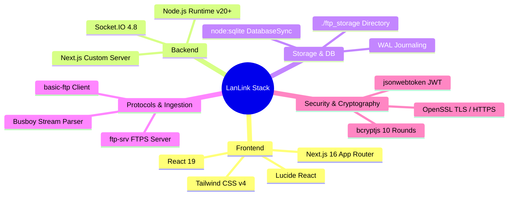
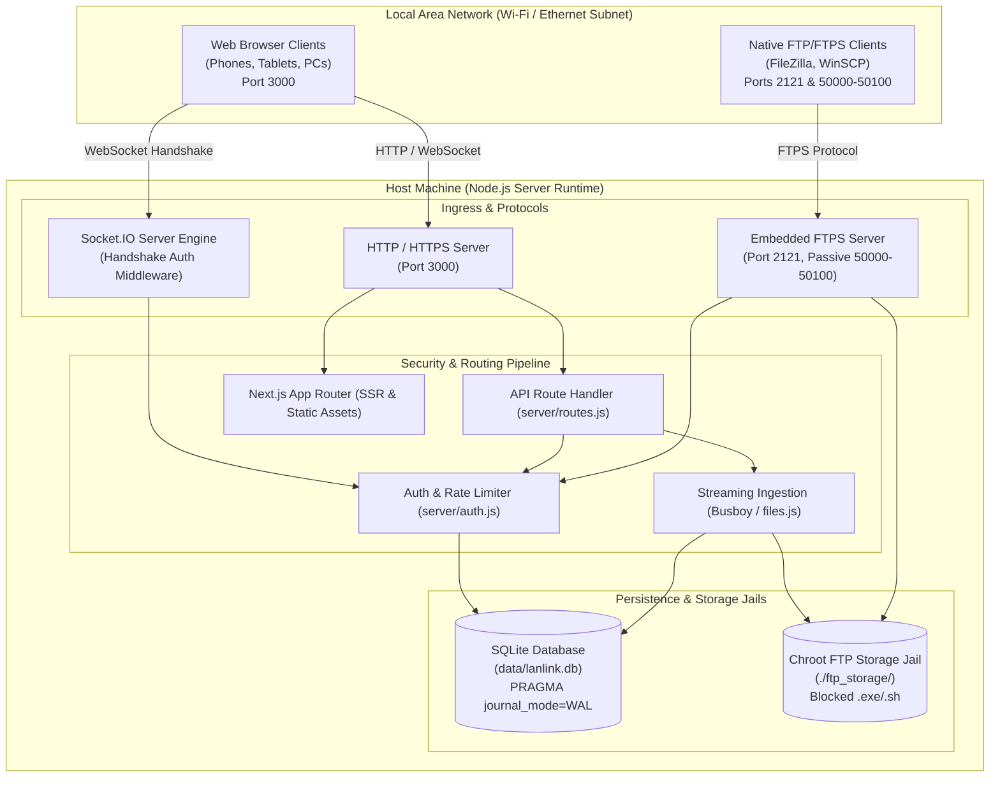

<div align="center">

  

  # LanLink
  ### Secure LAN Communication & High-Throughput FTPS System

  An air-gapped, zero-cloud real-time messaging, access-gated group collaboration, and embedded FTPS file-sharing platform engineered for high-security local area networks.

  [](https://nextjs.org/)
  [](https://react.dev/)
  [](https://socket.io/)
  [](https://nodejs.org/api/sqlite.html)
  [](https://en.wikipedia.org/wiki/FTPS)
  [](https://www.typescriptlang.org/)
  [](https://tailwindcss.com/)

  <p align="center">
    <a href="#-overview">Overview</a> •
    <a href="#-key-features">Key Features</a> •
    <a href="#-technology-stack">Tech Stack</a> •
    <a href="#-architecture--system-design">Architecture</a> •
    <a href="#-getting-started">Getting Started</a> •
    <a href="#-usage-guide">Usage Guide</a> •
    <a href="#-api--protocol-documentation">API & Protocols</a> •
    <a href="#-security-architecture">Security</a> •
    <a href="#-engineering-highlights">Engineering</a>
  </p>
</div>

---

## 📋 Table of Contents

- [Overview](#-overview)
- [Key Features](#-key-features)
- [Application Preview & Interfaces](#-application-preview--interfaces)
- [Technology Stack](#-technology-stack)
- [Architecture & System Design](#-architecture--system-design)
- [Getting Started](#-getting-started)
- [Environment Variables and Configuration](#-environment-variables-and-configuration)
- [Usage Guide](#-usage-guide)
- [Project Structure](#-project-structure)
- [API & Protocol Documentation](#-api--protocol-documentation)
- [Testing and Code Quality](#-testing-and-code-quality)
- [Security Architecture](#-security-architecture)
- [Engineering Highlights](#-engineering-highlights)
- [Roadmap](#-roadmap)
- [Contributing](#-contributing)
- [License](#-license)
- [Author & Acknowledgements](#-author--acknowledgements)

---

## 🌟 Overview

### The Problem
Modern team communication and file sharing tools (Slack, Microsoft Teams, WhatsApp, Google Drive) rely entirely on external cloud infrastructure. In environments such as **corporate internal networks, university research labs, medical facilities, on-site event productions, and air-gapped field operations**, routing sensitive messages and multi-gigabyte local files through remote third-party data centers introduces serious concerns:
- **Data Privacy & Compliance**: Sensitive IP, blueprints, and records leave the perimeter.
- **Bandwidth Waste & Congestion**: Sending large files over the public internet to colleagues sitting in the same room needlessly saturates uplink bandwidth.
- **Internet Dependency**: A temporary WAN outage halts all internal team communication.

### The Solution
**LanLink** is a self-hosted, cloudless communication and data transfer appliance designed to run on a single host computer within any Local Area Network (Wi-Fi or Ethernet switch). It offers instant full-duplex messaging, password-protected group channels, mutual peer verification, and a high-performance embedded FTPS file server that allows native FTP clients (FileZilla, WinSCP) and web browsers to transfer files without touching the public internet.

### What Distinguishes LanLink
- **Dual-Protocol Unified Host**: Runs a high-performance Next.js/Socket.IO web interface alongside an embedded TLS-secured FTP server (`ftp-srv`) on a single Node.js runtime.
- **Zero Cloud Footprint**: Data travels strictly between peer devices and the host server over the local IP subnet (`0.0.0.0` binding).
- **Zero-Dependency Native Storage**: Utilizes Node.js built-in `node:sqlite` in WAL (Write-Ahead Logging) mode, eliminating external database dependencies or native C++ compilation headaches (`node-gyp`).
- **Defense-in-Depth Security**: Enforces cryptographic password hashing (bcrypt), sliding-window brute-force account lockout, session-anchored WebSocket authentication, streaming file-type validation, and chroot storage isolation.

---

## ⚡ Key Features

### 🛡️ Authentication & Access Control
- **Cryptographic User Accounts**: Registration and authentication secured with `bcryptjs` (10 rounds) enforcing alphanumeric complexity requirements (minimum 8 characters with letters and numbers).
- **Session-Anchored Tokens**: Signed JSON Web Tokens (JWT) stored in `HttpOnly`, `SameSite=Strict` cookies, preventing script-based token theft (XSS-safe).
- **Brute-Force & Credential-Stuffing Defense**: Sliding-window rate-limiting tracks failed attempts per IP and username. Exceeding 5 failed attempts triggers an automated 15-minute lockout (HTTP 429).
- **Account Enumeration Prevention**: Employs uniform, generic error messages on login failure to deny attackers discovery of registered handles.
- **Optional Perimeter Room Gate**: Configurable server-wide room passphrase (`REQUIRE_ROOM_PASSWORD`) preventing unauthorized network discovery by passive LAN eavesdroppers.

### 💬 Real-Time Messaging & Direct Chat
- **Full-Duplex WebSockets**: Real-time message relay with millisecond latency powered by Socket.IO.
- **Strict Handshake Authorization**: Socket connections must pass cookie verification middleware; sender identity is extracted strictly from the cryptographic JWT session, making identity spoofing impossible.
- **XSS-Sanitized Delivery**: All incoming text is sanitized server-side using HTML entity escaping before broadcast, safeguarding client viewports.
- **Cross-Verification Chat Password Gates**: Direct messaging requires mutual cross-verification—users set a personal chat password that peers must enter before unlocking direct communication.

### 👥 Group Collaboration & Multi-Room Channels
- **Password-Gated Group Rooms**: Any authenticated user can host a dedicated group channel secured with a unique channel password.
- **Isolated Room Broadcasting**: Group communication leverages Socket.IO rooms (`group:<id>`), ensuring messages are strictly routed to verified members.
- **Persistent Group History**: Group messages and file attachments are stored in SQLite and automatically delivered when members enter the room.
- **Host Administration**: Channel creators possess administrative authority to disband and clean up group rooms and associated message history.

### 📁 Dual-Channel File Transfer & Embedded FTPS
- **Embedded FTPS Server**: Native FTP/FTPS server running on port `2121` with passive data ports (`50000-50100`) and optional TLS encryption.
- **Unified Credential System**: Users authenticate to the FTPS server using their existing LanLink account credentials; anonymous access is rejected by default.
- **Chrooted Storage Jail**: FTP sessions are strictly confined to `./ftp_storage/` with path-traversal safeguards preventing directory escapes.
- **In-Browser Streaming Uploads**: Web UI allows direct drag-and-drop or paperclip attachments up to 50 MB (configurable). File streams are parsed using `busboy` and piped directly to disk without memory buffering.
- **Malicious File Blacklisting**: Automatically rejects dangerous executable file types (`.exe`, `.bat`, `.cmd`, `.sh`, `.vbs`, `.ps1`).
- **Automated Lifecycle Retention**: A recurring background cleaner automatically purges shared files older than 7 days, maintaining disk health.

### 🌐 Zero-Configuration LAN Discovery
- **Local IP Discovery**: Server queries host network interfaces (`os.networkInterfaces`) and broadcasts active IPv4 addresses to clients.
- **Device & Hostname Resolution**: Reverse DNS (`dns.reverse`) and User-Agent heuristics identify connecting hardware (e.g., iPhone, Android, Windows PC, Mac) for frictionless peer recognition.

---

## 🖥️ Application Preview & Interfaces

| Interface | Component Responsibility | Security / Architectural Behavior |
|---|---|---|
| **Authentication Modal** | [`auth-modal.tsx`](file:///c:/Users/Admin/Downloads/LanLink/src/components/auth/auth-modal.tsx) | Handles user registration, bcrypt password policy validation, session token acquisition, and room access validation. |
| **Peer Chat Password Gate** | [`chat-password-gate.tsx`](file:///c:/Users/Admin/Downloads/LanLink/src/components/chat/chat-password-gate.tsx) | Enforces peer-to-peer cross-verification. Blocks direct message display until the peer's personal chat password is submitted. |
| **Direct & Group Chat Windows** | [`chat-window.tsx`](file:///c:/Users/Admin/Downloads/LanLink/src/components/chat/chat-window.tsx), [`group-chat-window.tsx`](file:///c:/Users/Admin/Downloads/LanLink/src/components/groups/group-chat-window.tsx) | Renders chronological message streams, formatted date separators, read receipts, and embedded file cards with download links. |
| **File Transfer Hub** | [`file-transfer-panel.tsx`](file:///c:/Users/Admin/Downloads/LanLink/src/components/files/file-transfer-panel.tsx) | Multi-tab panel (Received, Sent, All) showing real-time file transfer progress, MIME categorization, and secure download tokens. |
| **Network Status Bar** | [`bottom-status-bar.tsx`](file:///c:/Users/Admin/Downloads/LanLink/src/components/app/bottom-status-bar.tsx) | Displays live connection indicators, local subnet CIDR block, encryption status, and server build version. |

> [!NOTE]
> Visual assets including the official project emblem are located in [`public/logo.png`](file:///c:/Users/Admin/Downloads/LanLink/public/logo.png). Screenshots demonstrating active multi-device sessions should be stored in `docs/images/` for repository presentation.

---

## 🛠️ Technology Stack



### Stack Breakdown

| Layer | Technology | Version | Purpose in LanLink |
|---|---|---|---|
| **Frontend Framework** | **Next.js** | `16.3.3` | App Router-based component rendering, server-driven layouts, and static optimization. |
| **UI Library** | **React** | `19.2.8` | Component lifecycle, real-time reactive state management for active socket chats. |
| **Styling** | **Tailwind CSS** | `v4.0.0` | Modern, responsive dark-mode styling with zero runtime CSS overhead. |
| **Icons** | **Lucide React** | `1.37.0` | Lightweight, consistent SVG iconography across navigation, files, and status bars. |
| **Real-Time Engine** | **Socket.IO** | `4.8.3` | Bidirectional, full-duplex WebSocket communication with polling fallback and room isolation. |
| **Embedded Database** | **`node:sqlite`** | Native | Built-in synchronous SQLite engine with prepared statements and WAL journaling. |
| **FTP/FTPS Server** | **`ftp-srv`** | `4.6.3` | Embedded RFC 959 / RFC 2228 FTP/FTPS server with custom authentication and chroot support. |
| **FTP Testing Client**| **`basic-ftp`**| `6.2.3` | Script-driven client used in automated integration tests to verify FTP/TLS functionality. |
| **Multipart Ingestion**| **`busboy`** | `1.6.0` | High-throughput streaming parser for file uploads with backpressure to disk. |
| **Password Hashing** | **`bcryptjs`** | `3.0.3` | Salted 10-round password hashing for user accounts and group access keys. |
| **Session Security** | **`jsonwebtoken`** | `9.0.3` | Cryptographically signed, stateless session tokens delivered via HttpOnly cookies. |
| **Language & Tooling**| **TypeScript** | `5.x` | Static typing across chat models, file payloads, and client providers. |

---

## 🏗️ Architecture & System Design

LanLink operates a unified backend architecture where HTTP, WebSocket, and FTPS listeners coexist under one Node.js process.

### High-Level Topology



### Component Communication & Request Pipelines

#### 1. Session Authentication & Handshake Pipeline
1. Client submits credentials via `POST /api/auth/login`.
2. `server/auth.js` queries SQLite (`SELECT * FROM login_attempts WHERE key = ?`) to check for active lockout.
3. Password verified using `bcrypt.compareSync()`.
4. On success, server generates a signed JWT and returns an `HttpOnly`, `SameSite=Strict` cookie (`lanlink_session`).
5. Client browser initiates Socket.IO connection. The server-side middleware in `server.js` verifies the cookie token:
   - If invalid or absent: connection rejected (`Authentication required`).
   - If valid: `socket.user = { id, username }` is anchored to the socket session.

#### 2. Streaming File Upload Pipeline
1. Browser posts `multipart/form-data` to `POST /api/files/upload`.
2. `busboy` parses chunks as they arrive from the network interface.
3. `server/files.js` executes path-traversal sanitization (`path.basename`) and extension validation against `FTP_BLOCKED_EXTENSIONS`.
4. Chunks are piped directly into `fs.createWriteStream('./ftp_storage/f_<id>.<ext>')` with byte counting to enforce `FTP_MAX_FILE_SIZE_MB`.
5. File metadata is inserted into SQLite and broadcasted to clients in real time.

---

## 🚀 Getting Started

### Prerequisites
- **Node.js**: `v20.17.0` LTS or `>= v22.0.0` (Required for native `node:sqlite` DatabaseSync support).
- **Package Manager**: `npm` (v9+), `yarn`, or `pnpm`.
- **Operating System**: Windows 10/11, macOS, or Linux (Debian/Ubuntu/Arch).

### Installation & Setup

1. **Clone the Repository**:
   ```bash
   git clone https://github.com/atharva1407-sys/LanLink---SecureChat-System.git
   cd LanLink---SecureChat-System
   ```

2. **Install Dependencies**:
   ```bash
   npm install
   ```

3. **Configure Environment Variables**:
   ```bash
   cp .env.example .env
   ```
   *(Review and modify `.env` as needed. See [Environment Variables](#-environment-variables-and-configuration) below).*

4. **Generate TLS Certificates (Optional for HTTPS & FTPS)**:
   For local TLS transport security, generate self-signed certificates:
   - **Windows (PowerShell)**:
     ```powershell
     powershell -ExecutionPolicy Bypass -File scripts/generate-certs.ps1
     ```
   - **Linux / macOS (OpenSSL)**:
     ```bash
     mkdir -p certs
     openssl req -x509 -newkey rsa:2048 -nodes -keyout certs/key.pem -out certs/cert.pem -days 365 -subj "/CN=lanlink.local"
     ```

5. **Configure Firewall Inbound Rules**:
   To allow other devices on your Wi-Fi/Ethernet subnet to reach your server, open the listening ports:
   - **Windows (Run PowerShell as Administrator)**:
     ```powershell
     # Web UI & WebSockets (Port 3000)
     New-NetFirewallRule -DisplayName "LanLink Web (3000)" -Direction Inbound -LocalPort 3000 -Protocol TCP -Action Allow

     # FTPS Control Port (Port 2121)
     New-NetFirewallRule -DisplayName "LanLink FTPS Control (2121)" -Direction Inbound -LocalPort 2121 -Protocol TCP -Action Allow

     # FTPS Passive Data Range (Ports 50000-50100)
     New-NetFirewallRule -DisplayName "LanLink FTPS Passive (50000-50100)" -Direction Inbound -LocalPort 50000-50100 -Protocol TCP -Action Allow
     ```
   - **Linux (`ufw`)**:
     ```bash
     sudo ufw allow 3000/tcp
     sudo ufw allow 2121/tcp
     sudo ufw allow 50000:50100/tcp
     ```

6. **Start the Application**:
   ```bash
   npm run dev
   ```
   *Or on Windows, double-click the included launcher:*
   ```bat
   start.bat
   ```

7. **Access the Application**:
   - On the **host machine**: `http://localhost:3000`
   - On **peer phones, laptops, and tablets** on the same Wi-Fi:
     ```
     http://<host-lan-ip>:3000
     ```
     *(Your computer's LAN IP will be displayed in the terminal upon server start and inside the "Connect Devices" modal).*

---

## ⚙️ Environment Variables and Configuration

All configuration is managed through environment variables loaded via `dotenv` from `.env`.

| Variable | Type | Default | Required | Purpose & Technical Behavior |
|---|---|---|---|---|
| `PORT` | Integer | `3000` | No | HTTP / HTTPS web and WebSocket listening port. |
| `NODE_ENV` | String | `development` | No | Server runtime environment (`development` / `production`). |
| `ENABLE_HTTPS` | Boolean | `false` | No | Enables TLS for HTTP (`https://`) and WebSockets (`wss://`). |
| `SSL_CERT_PATH` | Path | `certs/cert.pem`| Conditional | Path to PEM-encoded X.509 public certificate (required if `ENABLE_HTTPS=true`). |
| `SSL_KEY_PATH` | Path | `certs/key.pem` | Conditional | Path to PEM-encoded private key (required if `ENABLE_HTTPS=true`). |
| `JWT_SECRET` | String | *dev fallback* | **Yes (Prod)** | Secret key for signing and verifying session JSON Web Tokens. |
| `JWT_EXPIRY` | String | `24h` | No | Session expiration duration format (e.g. `24h`, `7d`). |
| `REQUIRE_ROOM_PASSWORD`| Boolean | `false` | No | When `true`, requires all users to enter `CHAT_ROOM_PASSWORD` to register or log in. |
| `CHAT_ROOM_PASSWORD` | String | `LanSecret2026` | Conditional | Shared room password required if `REQUIRE_ROOM_PASSWORD=true`. |
| `MAX_LOGIN_ATTEMPTS` | Integer | `5` | No | Maximum consecutive failed login attempts before account/IP lockout. |
| `LOCKOUT_TIME_MINUTES`| Integer | `15` | No | Lockout duration in minutes when maximum failed attempts are reached. |
| `FTP_PORT` | Integer | `2121` | No | Embedded FTP/FTPS control channel listening port. |
| `FTP_PASV_MIN` | Integer | `50000` | No | Lower bound port for passive data transfer channels. |
| `FTP_PASV_MAX` | Integer | `50100` | No | Upper bound port for passive data transfer channels. |
| `FTP_STORAGE_DIR` | Path | `./ftp_storage` | No | Filesystem root directory for stored files and FTPS chroot jail. |
| `FTP_ENABLE_TLS` | Boolean | `true` | No | When `true`, enables explicit FTPS using certificates from `SSL_CERT_PATH`. |
| `FTP_MAX_FILE_SIZE_MB`| Integer | `50` | No | Maximum allowable uploaded file size in megabytes. |
| `FTP_BLOCKED_EXTENSIONS`| String | `.exe,.bat,...`| No | Comma-delimited list of blocked dangerous file extensions. |

> [!CAUTION]
> Never commit `.env` containing production passwords or sensitive secrets to version control. The repository `.gitignore` is pre-configured to strictly exclude `.env`, `.pem` certificates, and SQLite database files.

---

## 📖 Usage Guide

### 1. Creating an Account & Signing In
1. Visit `http://<host-ip>:3000` from any device on the network.
2. The **Authentication Modal** will appear. Select **Create LanLink Account**.
3. Choose a handle (3–20 alphanumeric characters) and an alphanumeric password (minimum 8 characters).
4. If the host administrator has enabled a Room Password, enter the shared passphrase and click **Create Account**.

### 2. Peer-to-Peer Cross-Verification (Direct Messaging)
1. In the sidebar under **Online Users**, click on an active peer.
2. LanLink will prompt you with the **Chat Password Gate**.
3. Direct chats require reciprocal cross-verification: ask the user for their personal chat password (each user has a default or can customize it in their profile).
4. Enter the password and click **Unlock Conversation**. Direct messages can now be exchanged in real time.

### 3. Creating & Moderating Group Channels
1. In the sidebar, click the **+** button next to **Groups**.
2. Name the group (e.g. `Dev-Sprint`) and assign a unique group password.
3. Share the password with team members. When they click on the group, entering the password unlocks the group channel.
4. The host retains administrative rights to delete the group and purge all associated room messages.

### 4. Sending & Downloading Files via Web UI
- **Chat Attachments**: Click the paperclip icon in the message input bar to attach documents, source code, images, or archives.
- **Dedicated Hub**: Open the **Files** tab on the sidebar or right panel to browse all files shared across the LAN.
- **Authorized Downloads**: Click **Download** on any file item to stream the file directly from `./ftp_storage/`.

### 5. Connecting via Native Desktop FTP Clients (FileZilla / WinSCP)
Users who prefer desktop FTP clients can connect directly to the embedded FTPS server:
1. Open **FileZilla** or **WinSCP**.
2. Configure connection settings:
   - **Host**: Your Host Machine's LAN IP (e.g., `192.168.1.50`)
   - **Protocol**: `FTP - File Transfer Protocol` (with `Require explicit FTP over TLS` if TLS is enabled)
   - **Port**: `2121`
   - **Logon Type**: `Normal`
   - **User**: Your LanLink username
   - **Password**: Your LanLink password
3. Click **Quickconnect**. You will be securely chrooted into `./ftp_storage/`.

---

## 📁 Project Structure

```
LanLink/
├── certs/                         # SSL/TLS certificates for HTTPS and FTPS (git-ignored)
│   ├── cert.pem                   # X.509 public certificate
│   └── key.pem                    # RSA private key
├── data/                          # SQLite persistent database storage (git-ignored)
│   └── lanlink.db                 # SQLite database file with WAL journal
├── ftp_storage/                   # Chrooted repository for shared LAN files (git-ignored)
├── public/                        # Static presentation assets
│   └── logo.png                   # Official LanLink branding icon
├── scripts/                       # Automation and test harnesses
│   ├── generate-certs.ps1         # PowerShell utility to generate self-signed TLS certs
│   └── test-lanlink.js            # Automated end-to-end integration test suite
├── server/                        # Core backend engine and security middleware
│   ├── auth.js                    # Bcrypt hashing, JWT issuance, brute-force rate limiter
│   ├── config.js                  # Central configuration loader and network interface scanner
│   ├── db.js                      # node:sqlite DatabaseSync schema & prepared statements
│   ├── files.js                   # Path traversal protection, file validation, retention purger
│   ├── ftp.js                     # Embedded ftp-srv FTPS server setup and auth hooks
│   └── routes.js                  # REST API endpoints, streaming busboy parser, cookie handlers
├── src/                           # Next.js App Router frontend
│   ├── app/
│   │   ├── globals.css            # Dark theme Tailwind CSS stylesheet
│   │   ├── layout.tsx             # Root layout wrapping application with SocketProvider
│   │   └── page.tsx               # Main reactive dashboard (Sidebar, Chat, Files, Settings)
│   ├── components/                # Modular React UI components
│   │   ├── app/                   # Shell components (app-header, sidebar, bottom-status-bar)
│   │   ├── auth/                  # Authentication modal dialogs
│   │   ├── chat/                  # Chat windows, headers, message bubbles, password gates
│   │   ├── files/                 # File transfer panel and file cards
│   │   ├── groups/                # Group creation modal and group chat windows
│   │   ├── providers/             # SocketContext provider & WebSocket event subscribers
│   │   └── users/                 # Online users list, list items, and user profile cards
│   ├── lib/
│   │   └── utils.ts               # Classname merging and utility helpers
│   └── types/                     # TypeScript definitions (chat.ts, file.ts, group.ts, user.ts)
├── .env.example                   # Safe template for environment configuration
├── .gitignore                     # Git exclusion rules (safeguarding credentials & data)
├── package.json                   # Project metadata, scripts, and dependency definitions
├── server.js                      # Main entrypoint: HTTP/HTTPS server + Socket.IO orchestration
├── start.bat                      # Windows one-click start script
└── tsconfig.json                  # TypeScript compiler configuration
```

---

## 📡 API & Protocol Documentation

### REST API Endpoints

All REST API endpoints are served on port `3000` via `server/routes.js`:

| Method | Endpoint | Auth | Request Body | Description & Status Codes |
|---|---|:---:|---|---|
| `POST` | `/api/auth/register` | None | `{ username, password, roomPassword? }` | Register new user. Sets `lanlink_session` cookie. Returns `201 Created` or `400/409`. |
| `POST` | `/api/auth/login` | None | `{ username, password, roomPassword? }` | Authenticates user. Enforces lockout. Returns `200 OK` or `401/429`. |
| `GET` | `/api/auth/me` | Cookie | None | Returns active user profile and room verification status (`200 OK`). |
| `POST` | `/api/auth/logout` | Cookie | None | Clears `lanlink_session` cookie (`200 OK`). |
| `GET` | `/api/chats/user-status`| Cookie | Query: `?targetUserId=<id>` | Checks if target user has a password configured (`200 OK`). |
| `POST` | `/api/chats/verify-user-password` | Cookie | `{ targetUserId, password }` | Verifies target peer's personal chat password (`200 OK` or `401`). |
| `GET` | `/api/users/my-chat-password` | Cookie | None | Retrieves user's own chat access password hint (`200 OK`). |
| `POST` | `/api/users/my-chat-password` | Cookie | `{ password }` | Updates user's personal chat password (`200 OK` or `400`). |
| `GET` | `/api/groups/list` | Cookie | None | Lists all active group channels (`200 OK`). |
| `POST` | `/api/groups/create` | Cookie | `{ name, password }` | Creates a new password-protected group room (`201 Created`). |
| `POST` | `/api/groups/verify` | Cookie | `{ groupId, password }` | Verifies channel password for room access (`200 OK` or `401`). |
| `GET` | `/api/groups/messages` | Cookie | Query: `?groupId=<id>` | Retrieves persistent message history for a group (`200 OK`). |
| `POST` | `/api/groups/delete` | Cookie | `{ groupId }` | Deletes group channel (Host only, `200 OK` or `403`). |
| `GET` | `/api/files/list` | Cookie | None | Lists all shared files available on storage (`200 OK`). |
| `POST` | `/api/files/upload` | Cookie | `multipart/form-data` | Streaming file upload to `./ftp_storage/` (`201 Created` or `400`). |
| `GET` | `/api/files/download` | Cookie | Query: `?id=<id>` | Authorized file download stream (`200 OK` or `401/404`). |
| `DELETE`| `/api/files/delete` | Cookie | Query: `?id=<id>` | Deletes specific file from storage and database (`200 OK`). |
| `POST` | `/api/files/clear` | Cookie | None | Purges all files from storage directory (`200 OK`). |

<details>
<summary><b>View WebSocket Events Specification</b></summary>

### WebSocket Protocol (Socket.IO)

#### Client-to-Server Events
- `send_message`: Emits direct message payload `{ receiverId, text?, fileAttachment? }`. Sender identity is enforced by server session.
- `join_group`: Subscribes socket to room `group:<groupId>`.
- `leave_group`: Unsubscribes socket from room `group:<groupId>`.
- `send_group_message`: Dispatches message `{ groupId, text?, fileAttachment? }` to group room and commits to SQLite.

#### Server-to-Client Broadcast Events
- `users_update`: Broadcasts updated array of online peer objects `{ id, userId, name, initials, ip, isOnline }`.
- `current_user`: Delivers verified session user profile to connected socket.
- `server_ips`: Broadcasts active IPv4 addresses of the host machine.
- `groups_update`: Broadcasts updated list of available group channels.
- `receive_message`: Delivers direct message to recipient and echoes to sender.
- `group_message`: Broadcasts room message to all sockets joined to `group:<groupId>`.
</details>

---

## 🧪 Testing and Code Quality

LanLink includes a comprehensive, automated end-to-end integration test suite located at [`scripts/test-lanlink.js`](file:///c:/Users/Admin/Downloads/LanLink/scripts/test-lanlink.js) that validates all security boundaries and file operations against a running server.

### Running Automated Integration Tests
Ensure the LanLink server is running (`npm run dev`), then execute the test suite in a separate terminal:
```bash
node scripts/test-lanlink.js
```

### Verified Test Assertions

```
====================================================
       LANLINK TEST SUITE: SECURITY & FTP           
====================================================

--- TEST 1: Password Policy Validation ---
[PASS] Rejects password shorter than 8 chars
[PASS] Rejects password lacking numbers

--- TEST 2: Registration & JWT Session ---
[PASS] User registration succeeds with valid credentials
[PASS] Sets HttpOnly session cookie on registration
[PASS] Rejects duplicate username (409 Conflict)

--- TEST 3: Login & Rate-Limiting / Lockout ---
[PASS] Successful login succeeds with 200 OK
[PASS] Generic error message on bad password
[PASS] Generic error message prevents user enumeration
[PASS] User locked out after 5 failed attempts (HTTP 429)

--- TEST 4: WebSocket Handshake Security ---
[PASS] Unauthenticated socket correctly rejected: "Authentication required"
[PASS] Authenticated socket connection successfully accepted

--- TEST 5: FTP Authentication & Chroot Isolation ---
[PASS] Anonymous FTP access rejected
[PASS] FTP login succeeds using chat account credentials

--- TEST 6: File Security, Path Traversal & File Transfer ---
[PASS] Path traversal in filename blocked
[PASS] Blocked file extension (.exe) rejected
[PASS] File upload succeeds and stores into FTP storage
[PASS] Unauthenticated download rejected (HTTP 401)
[PASS] Authenticated download succeeds with matching content

====================================================
TEST RESULTS: 15 PASSED, 0 FAILED
====================================================
```

### Code Quality & Static Analysis
```bash
npm run lint
```
Executes ESLint with `eslint-config-next` rules to enforce TypeScript and React best practices.

---

## 🔒 Security Architecture

| Security Measure | Implementation Mechanism | Threat Mitigated |
|---|---|---|
| **Cryptographic Password Storage** | `bcryptjs` salted hashing with 10 iterations | Database dump exposure, dictionary attacks |
| **Tamper-Proof Session Cookies** | HMAC-SHA256 JWT in `HttpOnly`, `SameSite=Strict` cookies | Cross-Site Scripting (XSS) token theft |
| **Brute-Force Rate Limiting** | Sliding window tracking IP & username in SQLite | Password guessing, credential stuffing |
| **Generic Auth Failure Messages** | Uniform `"Invalid username or password"` response | Username enumeration & account discovery |
| **Session-Anchored Sockets** | Identity verified during Socket.IO handshake | Socket impersonation and sender spoofing |
| **XSS Input Sanitization** | Server-side HTML entity escaping (`sanitizeText`) | Stored and reflected Cross-Site Scripting |
| **Chroot Jail & Path Traversal Guard**| `path.resolve` containment assertion in `files.js` | Directory traversal (`../../`) & file escape |
| **Dangerous Extension Blacklist**| Rejection of `.exe,.bat,.cmd,.sh,.vbs,.ps1` | Remote code execution on client machines |
| **SQL Injection Immunity** | Parameterized prepared statements (`node:sqlite`) | SQL injection vulnerabilities |

### Security Limitations & Honest Disclosures
- **Self-Signed Certificates**: When running HTTPS/FTPS locally, browsers and FTP clients will flag self-signed certificates as untrusted. Users must accept the local certificate or configure a local Certificate Authority (CA) using tools like `mkcert`.
- **Database at Rest**: SQLite database (`data/lanlink.db`) is stored locally on the host. Host filesystem encryption (BitLocker, FileVault, LUKS) is recommended for high-security environments.

---

## 💡 Engineering Highlights

### 1. Dual-Protocol Concurrent Architecture
Rather than requiring separate software packages for web chat and file transfer, LanLink harmonizes **Socket.IO over HTTP(S)** and **`ftp-srv` over FTPS** into a cohesive system. Both protocols query the same underlying SQLite user database and share the same chrooted storage directory, providing seamless interoperability between web browsers and desktop tools like FileZilla.

### 2. Zero-Dependency Native SQLite Synchronization
LanLink adopts Node.js’s modern built-in `node:sqlite` (`DatabaseSync`), bypassing external native addons such as `better-sqlite3` that require Python, Visual Studio C++ build tools, or platform-specific binaries. By enabling `PRAGMA journal_mode = WAL` (Write-Ahead Logging) and `PRAGMA busy_timeout = 5000`, the database supports high-concurrency read operations while preserving transactional write integrity.

### 3. Backpressure-Controlled Streaming Ingestion
Instead of buffering 50 MB file uploads in memory (which can exhaust the Node.js V8 heap during simultaneous multi-client uploads), LanLink uses `busboy` to parse incoming HTTP request streams and pipes data directly to write streams on disk. If an upload exceeds the configured size ceiling, the stream is aborted immediately, reclaiming storage and protecting server stability.

### 4. Non-Spoofable WebSocket Identity Association
In traditional chat applications, clients emit their username or ID as part of the socket payload. LanLink completely strips client authority over identity: during the socket handshake, the server extracts and verifies the signed JWT from the request cookie, stamping `socket.user` directly onto the socket object. When a message is broadcast, the sender name is injected exclusively from the authenticated session.

---

## 🗺️ Roadmap

- [x] Full-duplex WebSocket messaging via Socket.IO
- [x] Cryptographic authentication with bcrypt & JWT HttpOnly cookies
- [x] Sliding-window brute-force lockout defense
- [x] Embedded FTPS server (`ftp-srv`) with chroot storage isolation
- [x] Cross-verification personal chat password gates
- [x] Password-protected multi-room group collaboration
- [x] Streaming multipart file upload pipeline with path traversal defense
- [x] Automated 7-day storage lifecycle cleaner
- [x] End-to-end integration test runner (`scripts/test-lanlink.js`)
- [ ] End-to-End Encryption (E2EE) using Web Crypto API (`AES-256-GCM`)
- [ ] QR code generation in "Connect Devices" modal for instant mobile access
- [ ] Audio/Voice memo direct recording and streaming playback
- [ ] Bandwidth throttle controls per peer transfer session

---

## 🤝 Contributing

Contributions to LanLink are welcome! Please follow these steps:

1. **Fork the Repository**:
   Click the **Fork** button at the top right of the repository page.
2. **Create a Feature Branch**:
   ```bash
   git checkout -b feature/network-security-enhancement
   ```
3. **Commit Your Changes**:
   ```bash
   git commit -m "feat: add rate-limiting metrics to status bar"
   ```
4. **Validate Code Quality**:
   ```bash
   npm run lint
   node scripts/test-lanlink.js
   ```
5. **Push and Open a Pull Request**:
   ```bash
   git push origin feature/network-security-enhancement
   ```
   Open a Pull Request describing your changes, test results, and rationale.

---

## 📄 License

This project is currently distributed without an explicit open-source license. All rights are reserved by the repository maintainer. To discuss licensing or commercial use, please contact the repository owner.

---

## 👤 Author & Acknowledgements

- **Lead Developer**: [@atharva1407-sys](https://github.com/atharva1407-sys)
- **Repository**: [LanLink---SecureChat-System](https://github.com/atharva1407-sys/LanLink---SecureChat-System)

### Special Thanks
- [Next.js Team at Vercel](https://nextjs.org/) for the App Router architecture.
- [Socket.IO](https://socket.io/) for resilient real-time networking.
- [Lucide Icons](https://lucide.dev/) for crisp, modern interface iconography.
- The Node.js Core Team for the native `node:sqlite` database implementation.
